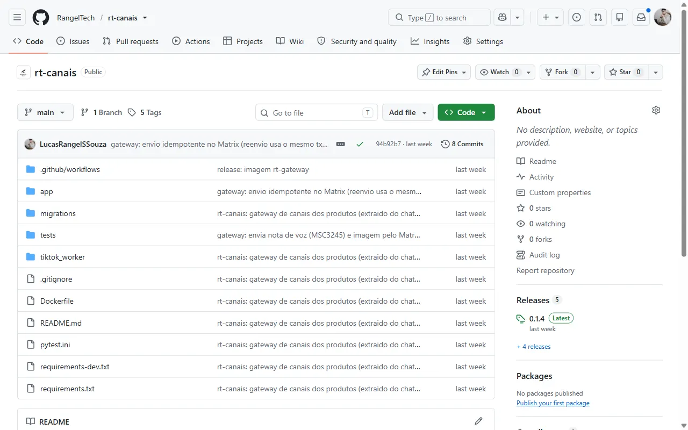

<!-- readme-padrao -->
# Canais (rt-gateway)

> Gateway de canais de mensagem (WhatsApp, Instagram, Facebook e TikTok) usado pelo LUAR e pelos produtos.

## O que é
Gateway de canais de mensagem (WhatsApp, Instagram, Facebook e TikTok) usado pelo LUAR e pelos produtos.

Estado: **no ar**.

## Onde está no ar
- Sem endereço público próprio.

## Onde faz o deploy
Este repositório **só publica** o artefato (release com imagem e manifesto); **quem implanta é o `vps_rt_infra`**.

- Serviço `rt-gateway`: `gh workflow run deploy.yml --repo RangelTech/vps_rt_infra -f service=rt-gateway` (só validar: `-f dry_run=true`; voltar versão: `-f version=<tag-antiga>`)

Os `.env` desses serviços são gerados do Infisical no momento do deploy (spec 57, seção 0A).

## Como funciona por dentro
Resumo acima; os detalhes estão nas notas técnicas (README anterior) abaixo e na spec 57.

## Segredos
Nenhum valor de segredo fica neste repositório. Os segredos dos serviços ficam no Infisical (mapa em `vps_rt_infra/scripts/infisical/mapa_envs.json`) e chegam à VPS gerados no deploy.

## Rodar e testar localmente
Ver as notas técnicas abaixo (cada repositório tem o seu jeito); os testes de QA em produção são por cliques reais, com evidência em `new_ragente/qa/evidencias`.

## Links
- Repositório: https://github.com/RangelTech/rt-canais
- Painel único: https://painel.rangeltech.net
- Spec de organização geral: `new_ragente/specs/57_ORGANIZACAO_GERAL_PRODUTOS_E_PAINEL.md`

## Notas técnicas (README anterior)

# rt-canais

Gateway de canais **dos produtos** (Atende AI, Grupo AI), separado do LUAR. Mesmo código do gateway do `chatwoot-rt/bridge`
(`app/channels`), sem nada do Chatwoot, com Synapse e pontes mautrix próprios (stack `rt-canais` no vps_rt_infra).

- WhatsApp, Messenger e DMs do Instagram pelas pontes mautrix (Matrix); TikTok pelo worker ReLttk (um processo por conta).
- API em `/internal/channels` (token), webhook assinado (HMAC) para cada produto, appservice Matrix em `/_matrix/app/v1`.
- Contrato: igual ao `docs/canais/CONTRATO_GATEWAY.md` do chatwoot-rt.
- Testes: `DATABASE_URL=postgresql://... python -m pytest -q` (Postgres descartável).

Deploy: release neste repo; implantação só pelo `vps_rt_infra` (stack `rt-canais`). Todo tráfego das pontes sai pelo proxy SP.
